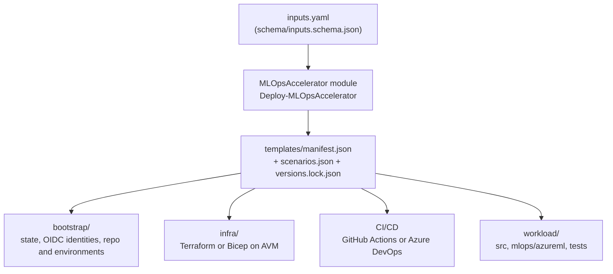

# Copilot instructions for mlops-v3

PowerShell module `Deploy-MLOpsAccelerator` (`src/MLOpsAccelerator`) that renders bootstrap, IaC (Terraform or Bicep on Azure Verified Modules), CI/CD (GitHub or Azure DevOps) and an Azure ML workload from one inputs file, across 11 scenarios. It is modelled on the ALZ Accelerator; mirror ALZ's structure and docs conventions where it makes sense.

## Architecture



Deployment flow: inputs file, then render, then bootstrap (once), then infra per environment through the pipelines, then workload pipelines. Phases map to the docs: 0 Planning, 1 Prerequisites, 2 Bootstrap, 3 Run.

## Layout

| Path | Purpose |
|---|---|
| `src/MLOpsAccelerator/` | The module. `New-MLOpsTokenMap` builds tokens; `Deploy-MLOpsAccelerator` runs the generation loop. |
| `schema/inputs.schema.json` | Validates inputs. Keep `inputs.example.yaml` and `docs/options/` in step. |
| `templates/` | Everything rendered. `manifest.json` maps sources to destinations (`when` is an equality check, `scope: workload` renders once per workload, `suffix_files` adds `-<name>` to filenames). Tokens are `[[token]]` and `[[#each_env]]`. |
| `docs/` | Hugo content, theme vendored in `site/themes/relearn`. Section pages are `_index.md`; order comes from front matter `weight`. |
| `tests/` | Pester tests and the scenario matrix. |
| `.github/workflows/` | `ci`, `codeql`, `e2e`, `pages`, `pr-title-check`, `release`. |
| `versions.lock.json` | Pins. Record any hold with its reason. |

## Rules

- Tests are offline. Never train a model in tests and never call Azure from them.
- Write files as UTF-8, LF, no BOM. The code must run on Windows, macOS and Linux (use `Join-Path`, no bash-only syntax in the module).
- Use the latest compatible libraries and AVM modules. Do not bump a held pin (`azurerm` below 5.0, `pyarrow` below 26, `azureml-mlflow` 1.60.0) without reading its reason.
- Policy is built-in Azure Policy only, at resource-group scope, effects `audit` or `deny`. No custom definitions and no DINE.
- Docs use Hugo Relearn shortcodes (`{}`, ``), not MkDocs admonitions, and US English spelling. Update `docs/whats-new.md`, and `docs/release-notes.md` for breaking changes. Hugo warnings fail CI.
- Be honest about what is verified. Scenario 1 is applied live (Terraform and Bicep) through the e2e workflow; other scenarios are verified by render, validate and plan or what-if only.

## Gotchas

- GitHub issues ID-based OIDC subjects (`repo:owner@ownerId/repo@repoId:environment:env`); federated credentials must use them.
- Public Bicep scenarios need explicit `Allow` network ACLs; the AVM defaults deny, which breaks Standard ACR and the AML storage access.
- `terraform fmt` is strict: pad `.tfvars` keys to the longest key, except `tags = {`.
- Soft-deleted Key Vaults and AML workspaces keep names reserved; use `name_suffix` (at most 4 characters for Bicep).
- The `e2e` environment is limited to `main` and needs an approval; it signs in with OIDC, no stored secrets.

## Validate

```powershell
Invoke-Pester ./tests                                   # offline, about a minute
./tests/Invoke-ScenarioMatrix.ps1 -Quick                # after template changes
./tests/Invoke-ScenarioMatrix.ps1 -Scenario basic-public -Iac terraform   # one scenario
cd site; hugo --minify                                  # docs must build with no warnings
```

The full matrix takes about 16 minutes. `terraform fmt` must be clean on rendered output.
