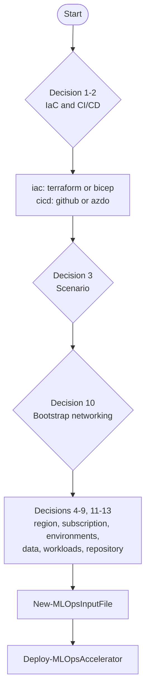
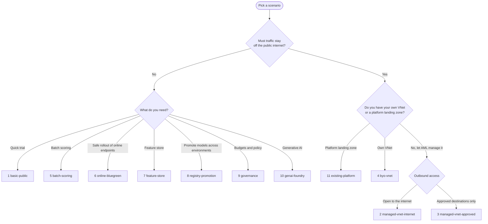
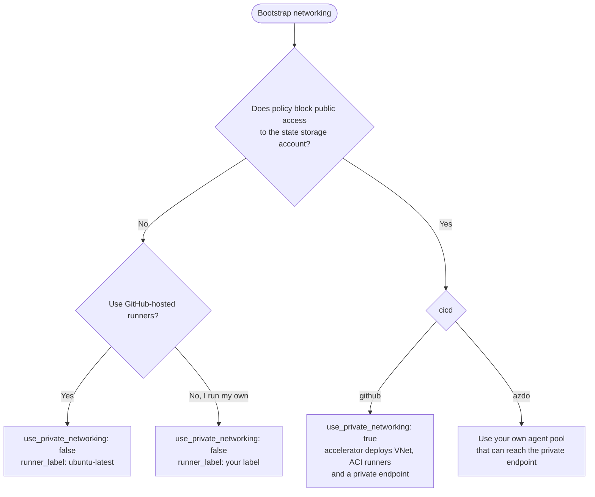
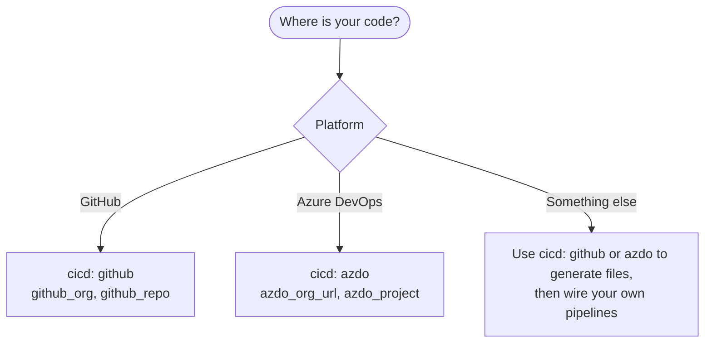

Use these flows to reach the values for `inputs.yaml`. The numbers refer to the [planning decisions](_index.md).

## Overall

## Choose a scenario (decision 3)

See the [scenarios](../scenarios/_index.md) page for cost and prerequisites of each.

## Choose the bootstrap networking (decision 10)

## Choose a version control system (decision 2)

